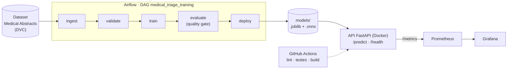
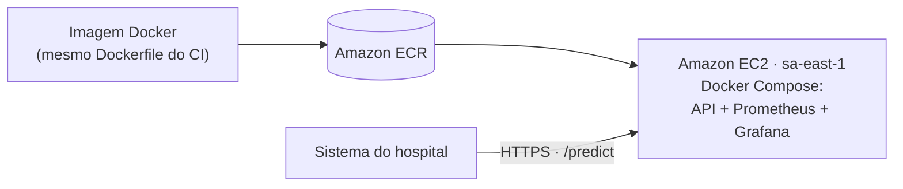

# Medical Triage — classificação de laudos médicos

[](https://github.com/GerBru/9-ml-engineering-03/actions/workflows/ci.yaml)

Tech Challenge da Fase 3 (FIAP — Machine Learning Engineering): **deploy de modelo em produção com pipeline CI/CD, monitoramento e otimização de latência**.

Um hospital precisa triar automaticamente laudos médicos em texto. Este projeto treina um classificador de texto (TF-IDF + Random Forest) que recebe o texto de um laudo e devolve uma de 5 categorias de condição médica, e cobre o ciclo de vida do modelo:

- **API REST** com FastAPI, empacotada em Docker;
- **CI** com GitHub Actions (lint, formatação, testes, build da imagem e smoke test);
- **Treino orquestrado** por uma DAG do Airflow, com quality gate;
- **Monitoramento** com Prometheus e Grafana;
- **Otimização de latência**: o modelo exportado para ONNX Runtime classifica um laudo cerca de 268 vezes mais rápido.

## Arquitetura



- O treino (`training/`) pode rodar direto (`python -m training.pipeline`) ou orquestrado pela DAG do Airflow. Os dois publicam o modelo em `models/`.
- A API (`src/medical_triage/`) carrega o modelo uma vez, no startup. Segue Clean Architecture: domínio, aplicação e infraestrutura (FastAPI e scikit-learn ficam na infraestrutura).
- A API expõe métricas em `/metrics`. O Prometheus coleta a cada 15 s e o Grafana mostra o dashboard **Medical Triage API**.

### Estrutura do repositório

```
.
├── src/medical_triage/          # API
│   ├── domain/                  #   entidades
│   ├── application/             #   ports, use cases, exceptions
│   ├── infra/api/               #   rotas FastAPI, schemas, métricas Prometheus
│   ├── infra/ml/                #   carregamento do modelo
│   └── main.py
├── training/                    # treino: ingest, validate, train, evaluate, pipeline,
│                                #   tuning, export/benchmark ONNX, config.yaml
├── airflow/                     # Airflow local: DAG, Dockerfile, docker-compose.yaml
├── monitoring/                  # configuração do Prometheus e do Grafana (provisioning)
├── models/                      # modelos publicados (.joblib, .onnx) e métricas
├── data/raw/                    # ponteiros DVC do dataset (os CSVs não ficam no Git)
├── tests/                       # testes pytest
├── scripts/                     # smoke test, benchmark e teste de carga da API
├── docs/                        # resultados e evidências
├── Dockerfile                   # imagem da API
├── docker-compose.yml           # API + Prometheus + Grafana
├── pyproject.toml / uv.lock     # dependências (uv)
└── binnacle.md                  # diário de bordo do desenvolvimento
```

## Pré-requisitos

| Ferramenta | Para quê |
| --- | --- |
| [Docker](https://docs.docker.com/get-docker/) com Docker Compose | API, monitoramento e Airflow. No Windows: Docker Desktop com WSL2 |
| [uv](https://docs.astral.sh/uv/getting-started/installation/) | Treino, testes e rodar a API sem Docker. Instala o Python 3.12 sozinho |
| Git | Clonar o repositório. No Windows, o Git Bash roda os scripts `.sh` |

## Início rápido: API + monitoramento

Não precisa do dataset: o modelo treinado já está versionado em `models/`.

```bash
git clone https://github.com/GerBru/9-ml-engineering-03.git
cd 9-ml-engineering-03
docker compose up -d --build
```

| Serviço | Endereço |
| --- | --- |
| API (docs interativas) | http://localhost:8000/docs |
| Prometheus | http://localhost:9090 (em *Status → Targets*, o alvo `medical-triage-api` deve estar `UP`) |
| Grafana | http://localhost:3000 — login `admin` / `admin`; dashboard **Medical Triage API** |

Testar a classificação:

```bash
curl -X POST http://localhost:8000/predict \
  -H "Content-Type: application/json" \
  -d '{"text": "patient with cardiac chest pain and heart failure"}'
# {"label":"cardiovascular diseases"}
```

No Windows (PowerShell):

```powershell
Invoke-RestMethod -Method Post -Uri http://localhost:8000/predict -ContentType "application/json" -Body '{"text": "patient with cardiac chest pain and heart failure"}'
```

Para o dashboard ter dados, gere tráfego (no Windows, pelo Git Bash):

```bash
./scripts/smoke_test.sh     # checa /health e /predict
./scripts/benchmark.sh      # 10 requisições, mostra média, mínimo e máximo
./scripts/load_test.sh      # teste de carga em degraus (precisa da ferramenta `hey`)
```

Para desligar: `docker compose down` (o `down -v` também apaga os dados do Prometheus e do Grafana).

### Rodar só a API, sem Docker

```bash
uv sync
uv run python -m medical_triage.main      # http://localhost:8000
```

## Dataset

[Medical Abstracts TC Corpus](https://github.com/sebischair/Medical-Abstracts-TC-Corpus) (Schopf, Braun e Matthes, 2023): resumos médicos em 5 classes (`neoplasms`, `digestive system diseases`, `nervous system diseases`, `cardiovascular diseases`, `general pathological conditions`), com 11.550 exemplos de treino e 2.888 de teste.

Os CSVs ficam em `data/raw/` e são versionados com **DVC**: o Git guarda só os ponteiros `.dvc`. O remote do DVC é uma pasta privada no Google Drive, então quem não é da equipe baixa direto do repositório público. Os arquivos são idênticos (o MD5 bate com os `.dvc`).

```bash
for f in medical_tc_train.csv medical_tc_test.csv medical_tc_labels.csv; do
  curl -L -o "data/raw/$f" "https://raw.githubusercontent.com/sebischair/Medical-Abstracts-TC-Corpus/main/$f"
done
```

No Windows (PowerShell):

```powershell
foreach ($f in "medical_tc_train.csv", "medical_tc_test.csv", "medical_tc_labels.csv") {
  curl.exe -L -o "data/raw/$f" "https://raw.githubusercontent.com/sebischair/Medical-Abstracts-TC-Corpus/main/$f"
}
```

Quem tem acesso ao remote: `uv run dvc pull`.

## Treino

```bash
uv sync --group dev --group training
uv run python -m training.pipeline
```

O pipeline (`training/pipeline.py`) roda `ingest → validate → train → evaluate` e publica em `models/`:

- `random_forest_pipeline.joblib`: o Pipeline do scikit-learn (TF-IDF + Random Forest), que a API carrega;
- `random_forest_pipeline.onnx`: o mesmo modelo em ONNX, publicado só se as predições baterem com as do scikit-learn em pelo menos 99% do conjunto de teste;
- `random_forest_metrics.json`: métricas no conjunto de teste.

Hiperparâmetros e caminhos ficam em `training/config.yaml`. Outros comandos:

| Comando | O que faz |
| --- | --- |
| `uv run python -m training.export_onnx` | Exporta o `.joblib` já publicado para ONNX, sem retreinar |
| `uv run python -m training.benchmark_onnx` | Compara a latência do scikit-learn com a do ONNX e grava `docs/latency_benchmark.json` |
| `uv run python -m training.tuning` | Busca de hiperparâmetros (`RandomizedSearchCV`). Lê os CSVs de `../Medical_Abstracts_TC_Corpus/` (ver o docstring do script) |

## Treino orquestrado com Airflow

A DAG `medical_triage_training` (`airflow/dags/training_dag.py`) executa o mesmo pipeline em 5 tasks:

```
ingest_data → validate_data → train_model → evaluate_model → deploy_model
```

- **Quality gate:** o `evaluate_model` falha, sem retry, se o F1-macro no teste ficar abaixo de 0.50. Nesse caso o `deploy_model` não roda.
- **Boas práticas:** retries com backoff, timeout por task e callback de alerta em falha.

Com os CSVs em `data/raw/`:

```bash
cd airflow
echo "AIRFLOW_UID=$(id -u)" > .env     # só no Mac/Linux; no Windows não precisa
docker compose up airflow-init         # 1ª vez: constrói a imagem e cria o banco
docker compose up -d
```

1. Abra http://localhost:8080 (login `airflow` / `airflow`).
2. Ative a DAG `medical_triage_training` e clique em **Trigger**.
3. As 5 tasks devem terminar verdes, e o modelo é publicado em `models/` na raiz do repositório.

Para desligar: `docker compose down`. Evidência de execução: [`docs/airflow_runs.jpeg`](docs/airflow_runs.jpeg).

## Testes e qualidade

```bash
uv run pytest                    # 26 testes (2 são pulados sem os CSVs em data/raw/)
uv run ruff check .              # lint
uv run ruff format --check .     # formatação
uv run pytest --cov=training --cov=src/medical_triage --cov-report=term-missing   # cobertura
```

O CI (`.github/workflows/ci.yaml`) roda a cada push na `develop`/`main` e em todo PR. Ele faz lint, formatação e testes, e depois o build da imagem Docker com smoke test.

## Resultados

**Modelo** (conjunto de teste, 2.888 laudos): TF-IDF com 10.000 termos + Random Forest com 289 árvores (hiperparâmetros por `RandomizedSearchCV`):

| Métrica | Valor |
| --- | --- |
| Accuracy | 0.564 |
| F1-macro | 0.558 |

**Latência de inferência** (um laudo por vez, só o modelo). Detalhes em [`docs/otimizacao_onnx.md`](docs/otimizacao_onnx.md):

| Variante | p50 | p99 |
| --- | --- | --- |
| scikit-learn (`.joblib`, como publicado) | 13,50 ms | 14,69 ms |
| **ONNX Runtime** (`.onnx`) | **0,050 ms** | **0,079 ms** |

O ONNX é cerca de 268 vezes mais rápido no p50, com 100% das predições iguais às do scikit-learn. A API ainda serve o `.joblib`.

**Monitoramento** (dashboard do Grafana, ~7,3 req/s no `/predict`): p95 de ~48 ms e 0% de erros 5xx. No teste de carga, a API chegou a ~70 req/s. Detalhes no [`binnacle.md`](binnacle.md).

## Decisão de arquitetura em nuvem

Análise pedida na Etapa 1 do desafio. É uma **proposta**: o deploy em nuvem não foi executado, e a stack roda localmente com Docker Compose.

### Tempo real, não batch

A API precisa classificar o laudo no momento em que ele chega: numa triagem, o resultado só tem valor se vier na hora. Isso descarta o deploy em batch, cuja latência (minutos a horas) é incompatível com decisões imediatas. O modelo também favorece o tempo real: TF-IDF + Random Forest roda só em CPU, ocupa ~200 MiB de memória e classifica um laudo em ~13,5 ms. É um modelo leve, que fica carregado em memória e responde com latência previsível.

O batch entra só como complemento: reprocessar um lote histórico de laudos ou retreinar o modelo, que hoje é feito pela DAG do Airflow.

### Por que não serverless

Um serviço serverless (ex.: AWS Lambda) cobra só pelo uso e escala sozinho, mas não se encaixa neste caso:

- **Monitoramento:** o Prometheus coleta as métricas buscando o `/metrics` da API de tempos em tempos. Isso exige um processo que fique de pé. Numa função efêmera, os contadores e o histograma de latência ficam na memória de cada execução e se perdem, e a stack de monitoramento do projeto deixaria de funcionar como está.
- **Cold start:** cada nova instância precisaria carregar o scikit-learn e um modelo de 22,5 MB antes de responder, o que torna a latência imprevisível justamente quando o sistema escala.
- **Perfil de demanda:** serverless compensa com demanda intermitente. Um hospital gera fluxo contínuo de laudos, e aí um serviço sempre ativo é o padrão indicado.

### Provedor: AWS

Os três provedores oferecem serviços equivalentes para o mesmo desenho:

| Papel | AWS | Azure | GCP |
| --- | --- | --- | --- |
| Registro de imagens | ECR | ACR | Artifact Registry |
| Tempo real (VM) | EC2 | Virtual Machine | Compute Engine |
| Serverless | Lambda | Container Apps | Cloud Run |
| Batch | AWS Batch | Container Apps Jobs | Cloud Run Jobs |
| Plataforma gerenciada | SageMaker | Azure ML | Vertex AI |

Para um modelo leve, só com CPU, nenhum dos três tem vantagem técnica decisiva. O critério de desempate foi a **experiência da equipe**: um dos integrantes trabalha com AWS no dia a dia, o que reduz o risco operacional e torna mais rápida e segura a configuração de permissões (IAM) e de rede.

### Arquitetura proposta



- **Amazon ECR** guarda a imagem da API, gerada pelo mesmo `Dockerfile` que o CI já constrói.
- **Amazon EC2** roda a stack com o mesmo `docker-compose.yml` validado localmente. Uma instância pequena, só com CPU, basta: no teste de carga, um processo atendeu ~70 req/s, e o `/predict` é limitado por CPU.
- **Região `sa-east-1` (São Paulo)**, pela proximidade do hospital e por se tratar de dados de saúde, que a LGPD classifica como sensíveis.
- **Descartado: endpoint do SageMaker.** Ele traz escalonamento gerenciado, mas acrescenta custo e complexidade desproporcionais para um modelo scikit-learn de 22,5 MB, e exigiria adaptar o monitoramento.

**Se a demanda crescer:** mais workers do uvicorn por instância, uma instância maior ou várias instâncias atrás de um load balancer. Servir o modelo em ONNX (0,05 ms por inferência, contra 13,5 ms no scikit-learn) também tira o modelo da posição de gargalo.

### Custo e segurança

- **Custo:** tempo real significa custo constante, com a instância ligada 24 horas por dia. É o preço aceito pela resposta imediata, e por isso a instância deve ser pequena e os ambientes de teste, desligados quando ociosos.
- **Segurança:** laudos são dados sensíveis. Proposta: HTTPS na API, criptografia dos volumes, permissões com menor privilégio (a instância só pode baixar imagens do ECR), Prometheus e Grafana fechados ao acesso público e, numa evolução, autenticação e limite de requisições na API contra abuso e extração do modelo.

## Documentação

- [`binnacle.md`](binnacle.md): diário de bordo, com as decisões técnicas por data e por autor.
- [`docs/otimizacao_onnx.md`](docs/otimizacao_onnx.md): otimização de latência com ONNX.
- [`docs/Tech Challenge Fase 03.pdf`](docs/Tech%20Challenge%20Fase%2003.pdf): enunciado do desafio.

### Equipe

| Integrante | E-Mail |
| --- | --- |
| Fellipe Bastos | fellipe.resende@hotmail.com |
| German Brunner | brunner.brunner@gmail.com |

## Checklist do Tech Challenge

Baseado nos requisitos de `docs/Tech Challenge Fase 03.pdf`.

### Repositório GitHub (Requisitos Obrigatórios)

- [x] Modelo de classificação de texto (NLP): TF-IDF + Random Forest (`training/`, `models/random_forest_pipeline.joblib`)
- [x] API REST com FastAPI (`src/medical_triage/`)
- [x] Dockerfile funcional para o serviço de inferência
- [x] Pipeline CI/CD básico com GitHub Actions (lint → test → build) (`.github/workflows/ci.yaml`); CD fica fora do escopo
- [x] Script ou DAG Airflow simples para pipeline de treino/retreino (`airflow/dags/training_dag.py`)
- [x] Stack de monitoramento local: API + Prometheus + Grafana via Docker Compose
- [x] Histórico de commits semântico e organizado

### Boas Práticas Obrigatórias

- [x] CI/CD com pelo menos 2 automações (lint + testes) — `ruff check`, `ruff format --check` e `pytest` a cada push/PR; os 2 testes que usam o dataset real são pulados no CI (dados no DVC, fora do Git)
- [x] DAG Airflow funcional (ingestão → treino → salvamento do modelo) — `ingest → validate → train → evaluate → deploy`, com quality gate; executada com sucesso no Airflow 2.10.4 via Docker Compose ([`docs/airflow_runs.jpeg`](docs/airflow_runs.jpeg))
- [x] Dashboard Grafana com pelo menos 3 painéis
- [x] Otimização de performance (ONNX, quantização ou pruning) — Pipeline exportado para ONNX e executado com ONNX Runtime ([`docs/otimizacao_onnx.md`](docs/otimizacao_onnx.md))

### Etapa 1 — Decisão Arquitetural e API Inicial

- [x] Decisão de estratégia de deploy em nuvem documentada no README (AWS/Azure/GCP, batch vs. real-time) — tempo real na AWS (ECR + EC2), em [Decisão de arquitetura em nuvem](#decisão-de-arquitetura-em-nuvem)
- [x] API FastAPI que recebe texto do laudo e retorna a classificação
- [x] API empacotada em container Docker
- [x] Medição de tempo de resposta / baseline de latência local (`scripts/benchmark.sh`)

### Etapa 2 — CI/CD e Pipeline Automatizado

- [x] Workflow GitHub Actions rodando lint + pytest a cada push (push em `develop`/`main` e em todo PR)
- [x] DAG Airflow simulando o treino (task de leitura de CSV + task de treino/salvamento) — `ingest_data` lê os CSVs; `train_model` e `deploy_model` treinam e salvam em `models/`
- [x] Pipeline de treino já modular, pronto para virar tasks da DAG (`training/ingest.py`, `validate.py`, `train.py`, `evaluate.py`, `pipeline.py`)

### Etapa 3 — Monitoramento e Observabilidade

- [x] API instrumentada com `prometheus_client` (tempo de requisição, contagem de chamadas) — `src/medical_triage/infra/api/metrics.py` (`http_requests_total`, `http_request_duration_seconds`), exposto em `/metrics`
- [x] `docker-compose.yml` com API + Prometheus + Grafana
- [x] Dashboard Grafana configurado e exibindo as métricas

### Etapa 4 — Otimização de Latência e Entrega

- [x] Classificador de texto treinado (TF-IDF + Random Forest)
- [x] Técnica de otimização de latência aplicada (ex.: ONNX, quantização ou pruning) — ONNX Runtime (`models/random_forest_pipeline.onnx`, 100% de paridade com o original no conjunto de teste)
- [x] Comparação de latência: modelo original vs. otimizado — p50 de 13,5 ms (scikit-learn) para 0,050 ms (ONNX) por laudo, só a inferência ([`docs/otimizacao_onnx.md`](docs/otimizacao_onnx.md))
- [ ] Vídeo STAR gravado (≤ 5 minutos)

### Dataset

- [x] Dataset com ≥ 2.000 amostras — Medical Abstracts TC Corpus (11.550 treino + 2.888 teste)
